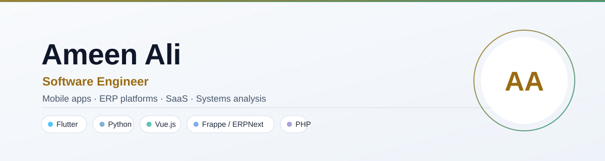

<picture>
  <source media="(prefers-color-scheme: dark)" srcset="assets/banner-dark.svg">
  
</picture>

---

## About

I am a software engineer who builds **complete products**: the mobile app in the user's hand, the server and ERP behind it, the web portal that manages it, and the subscription and permission layers that decide who may use what.

My work spans **mobile, web, backend and systems**, and I am most useful where these meet: turning a business process into software that stays correct under real conditions (weak networks, concurrent users, partial failures, and strict permissions).

## Areas of work

| | |
|---|---|
| **Mobile applications** | Cross-platform apps with Flutter and Dart, Arabic right-to-left interfaces, state management, offline-tolerant workflows, Firebase services |
| **Web & frontend** | Vue.js portals and dashboards, JavaScript interfaces, responsive HTML/CSS |
| **Backend & ERP** | Python services, Frappe / ERPNext applications, versioned server APIs, multi-company configuration, PHP back-ends |
| **SaaS & access control** | Central Control Plane, subscription plans and grace periods, per-customer feature grants, server-enforced permissions |
| **Systems & servers** | Linux administration over SSH, deployment and environment setup, infrastructure tooling, security platform work |
| **Systems programming** | C++ projects and coursework |

## Public work

- **[Smart-Restro](https://github.com/AMN-2/Smart-Restro)**: restaurant management system for Smart Choice.
- **[marley-healthcare](https://github.com/AMN-2/marley-healthcare)**: open-source, enterprise health information system.
- **[ameen-ali-hub](https://github.com/AMN-2/ameen-ali-hub)**: configuration for this profile.

Most of my professional work is in private repositories for clients and internal platforms.

## GitHub at a glance

  
  

  

## Technology stack

**Mobile & client**

**Web & frontend**

**Backend & data**

**Systems & languages**

**Tooling & delivery**

## How I approach a system

1. **Contract first.** I write the integration contract (requests, responses, error codes, idempotency rules) and agree it before building the client.
2. **Permission matrix.** Every action maps to the rule that allows it, including parent and child dependencies, so no path opens by accident.
3. **Failure modes.** I design for partial failures, retries, offline use and concurrent changes. A retry must never duplicate a business document.
4. **Decisions on record.** Accounting, data and access decisions are written down with the reasons and the approvers.
5. **Tested rules.** Each permission and business rule has a test. Static analysis and the full suite run on every change.

## Working style

I use AI coding assistants in daily development to draft and review code, write tests, and check documentation against the implementation. The decisions and their verification remain mine.

## Contact

GitHub: [@AMN-2](https://github.com/AMN-2)
